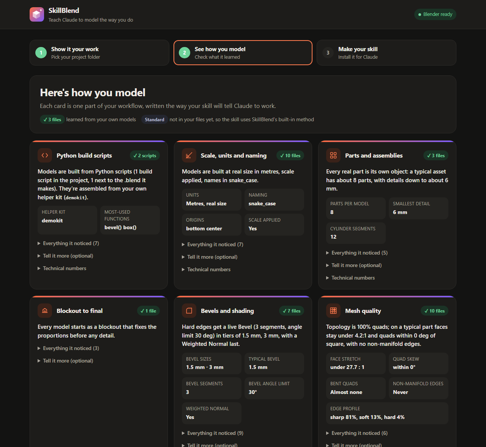
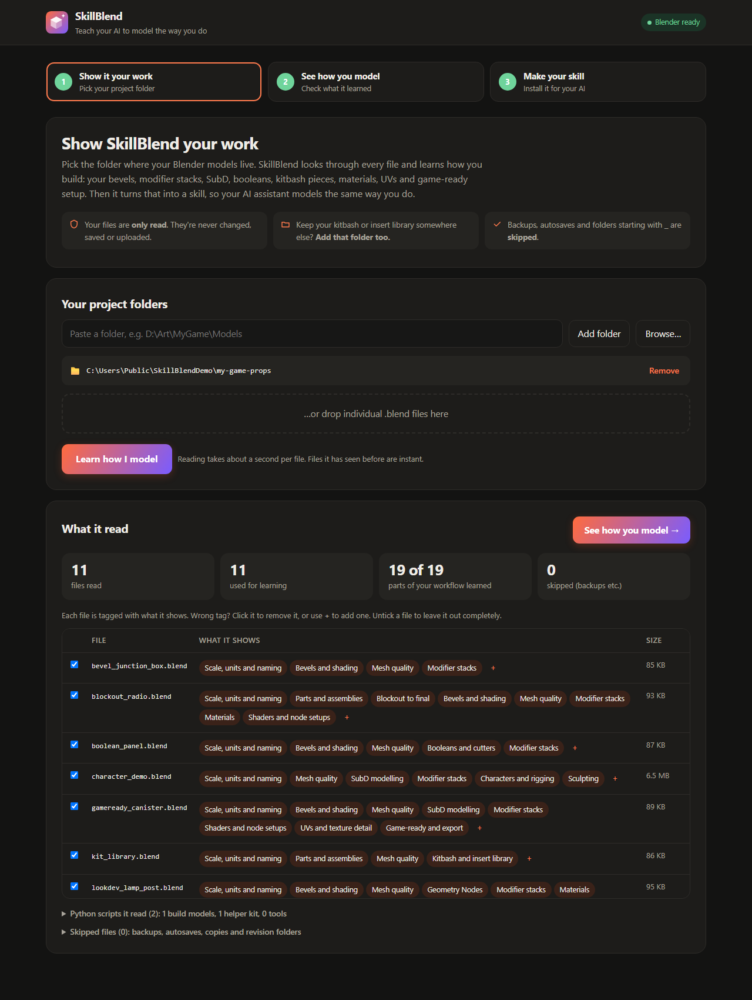
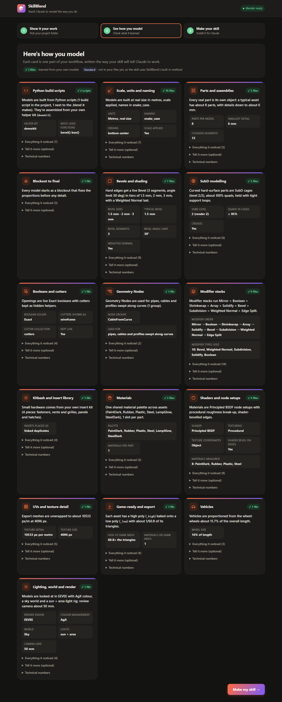
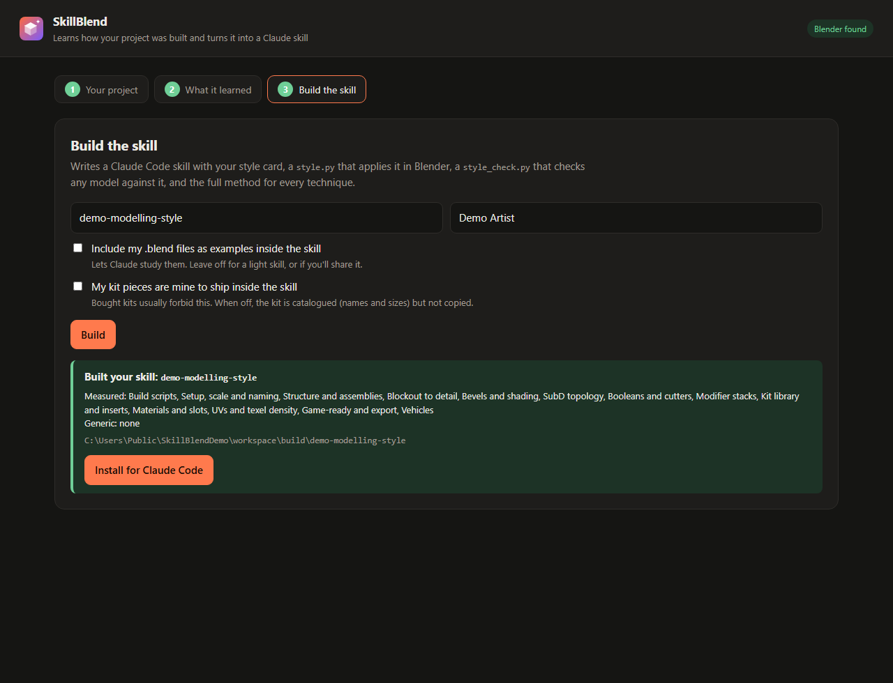
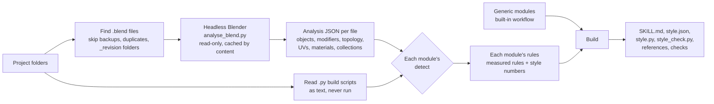

<p align="center">
  
</p>

<h1 align="center">SkillBlend</h1>

<p align="center"><b>Point it at your Blender project. It learns how you model and writes a skill your AI assistant uses to model the same way: Claude Code, OpenAI Codex, Cursor, Gemini CLI, GitHub Copilot, Windsurf, or any chat model, local ones included.</b></p>

<p align="center">
  
</p>

SkillBlend is a local app for Blender artists who work with an AI assistant. Point it at your project. It reads your `.blend` files (and the Python build scripts next to them, if you have any) and works out how you build models: how you bevel, your stack order, how you hold SubD edges, how you cut openings, your kit pieces, your materials and node setups, your texel density, your high/low setup, your characters, rigs and sculpts. Then it writes all of that into a **skill** your assistant follows, so when you ask it to model something in Blender, it works your way and checks its own result against your style.

The skill is an [Agent Skills](https://agentskills.io) folder, the format [Claude Code](https://claude.com/claude-code), OpenAI Codex, Cursor, Gemini CLI, GitHub Copilot and Windsurf all read, so one build installs for all of them. It also comes as a ready-made system prompt for any chat model, including local models in Ollama or LM Studio.

- **Nothing to fill in.** You don't answer an interview or tag files. SkillBlend sorts your files by technique itself.
- **Measured, not guessed.** Every rule in the skill comes from your files, with the numbers and how many files they came from.
- **Original work.** The built-in workflow is written from SkillBlend's own models, measurements and Blender tests (see [Acknowledgements](#acknowledgements) for where it started).
- **Gaps are covered.** Any technique your project doesn't show uses a complete, tested built-in workflow.
- **Local and read-only.** Blender opens your files in the background and never saves them. Nothing is uploaded.

---

## Install it with one prompt

Use a coding assistant that can run commands (Claude Code, Codex, Cursor, Gemini CLI, Copilot, Windsurf...)? Paste this in and it does the rest: it installs SkillBlend, learns your files and installs your skill for itself. It only stops to ask you a few questions. (Also in [INSTALL_WITH_AI.md](INSTALL_WITH_AI.md).)

```text
Install SkillBlend (https://github.com/1337VIPER/skillblend) and use it to learn how I model in Blender, then make me a skill for you from it.

1. Ask me where to put it (default: a "skillblend" folder in my home folder) and clone the repo there.
2. Check that Python 3.9 or newer is available, and find my Blender install (4.2 or newer). If you can't find Blender, ask me for the path. Then run:
   python skillblend.py config --blender "<path to blender>"
3. If you are Claude Code, install the SkillBlend helper skill: python skillblend.py install-driver
   (Other assistants: read AGENTS.md in the repo instead; it explains the same steps.)
4. Ask me which folder holds my Blender models, and whether I keep a kitbash or insert library in another folder. Then run:
   python skillblend.py learn "<models folder>" ["<kit folder>"]
5. Run "python skillblend.py report" and explain to me, in plain language, what it learned about how I model. Point out anything that looks off, and ask whether I want to leave any file out.
6. Ask me three things: what to call my skill, whether my kitbash pieces are my own work (if yes, run: python skillblend.py answer kit-library kit_redistribute true), and whether to copy my .blend files into the skill so you can study them (if yes, add --examples). Then build it:
   python skillblend.py build --name "<name>" [--examples]
7. Install it for the assistant I'm using, with --for set to yourself: claude (Claude Code), codex (OpenAI Codex), cursor, gemini (Gemini CLI), copilot or windsurf. Ask me whether I want it in every project or only one; for only one, add --project-dir:
   python skillblend.py install "<the folder the build printed>" --for <you> [--project-dir "<project>"]
   If it says the skill is already installed, ask me first, then add --force: that updates it and keeps anything I added to it.
   If I use a plain chat model (ChatGPT, a local model in Ollama or LM Studio), give me exports/system-prompt.md from the built folder to paste in as the system prompt.
8. Tell me to start a new session, and give me two example prompts to try my new skill.

Never open, change or save any of my .blend files: SkillBlend only reads them. If I'd rather click through it myself, run "python skillblend.py app" instead of steps 4 to 7 and tell me to follow the three steps in my browser.
```

Prefer to click through it yourself? See [Quick start](#quick-start).

## Contents

- [Install it with one prompt](#install-it-with-one-prompt)
- [Use it with any AI](#use-it-with-any-ai)
- [Quick start](#quick-start)
- [Using the app, step by step](#using-the-app-step-by-step)
- [What you get](#what-you-get)
- [Does it work? Run the eval](#does-it-work-run-the-eval)
- [Works with Refine3D](#works-with-refine3d)
- [How it works](#how-it-works) (the full version is in [docs/how-it-works.md](docs/how-it-works.md))
- [What it learns](#what-it-learns)
- [Command line](#command-line)
- [Privacy and licences](#privacy-and-licences)
- [Extending SkillBlend](#extending-skillblend)
- [Tests](#tests)

## Use it with any AI

Every skill SkillBlend builds works with several assistants. Pick them in the app's last step, or on the command line:

```bash
python skillblend.py install workspace/build/my-style                  # Claude Code
python skillblend.py install workspace/build/my-style --for codex      # Codex, Cursor, Gemini CLI, Copilot and Windsurf, in every project
python skillblend.py install workspace/build/my-style --for cursor --project-dir D:/Art/MyGame   # the same, for one project only
```

| Assistant | Where the skill goes |
|---|---|
| Claude Code | `~/.claude/skills/<name>/` (or `<project>/.claude/skills/<name>/` with `--scope project`) |
| OpenAI Codex, Cursor, Gemini CLI, GitHub Copilot, Windsurf | one shared copy in `~/.agents/skills/<name>/`, or `<project>/.agents/skills/<name>/` with `--project-dir`. All five read `.agents/skills`, so naming any one of them installs for all |
| A tool that reads `AGENTS.md` but not skills | `--for agents-md --project-dir <project>` adds a few lines to the project's `AGENTS.md` that point at the skill |
| Any chat model (ChatGPT, Ollama, LM Studio, Open WebUI...) | `exports/system-prompt.md`, a compact self-contained prompt (about 16k characters) to paste as the system prompt |

Each tool loads the skill by itself when you ask for Blender work. The note in `AGENTS.md` sits in a marked block that's replaced on reinstall, so the rest of your file is never touched.

**Updating keeps your work.** Rebuild and install again with `--force`, and SkillBlend updates the installed skill file by file. Files you added to it stay. Sections you wrote into `SKILL.md` move to `NOTES.md`, which every skill tells the AI to read first and SkillBlend never changes, so that's the place for your own rules. Anything of SkillBlend's that you edited is saved to `workspace/backups/` before it's replaced.

## Quick start

**You need:** Blender 4.2 or newer (developed and tested on 5.2), Python 3.9 or newer (no packages to install), and a web browser. To *use* the skill you build, you need an AI assistant that reads skills (Claude Code, OpenAI Codex, Cursor, Gemini CLI, GitHub Copilot, Windsurf) or any chat model you can give a system prompt.

```bash
git clone https://github.com/1337VIPER/skillblend.git
cd skillblend
python skillblend.py app
```

Your browser opens SkillBlend at `http://127.0.0.1:4970`. If Blender isn't found automatically, the app asks for the path to `blender.exe` (or the Blender app on macOS / the `blender` binary on Linux).

**No project to hand?** Make the demo project and learn that:

```bash
python skillblend.py demo        # writes workspace/demo-project: 9 small .blend files and a build script
```

Then add `workspace/demo-project` as your project folder in the app.

## Using the app, step by step

### 1. Show it your work

Add the folder where your models live: paste a path, or use **Browse…**. If your kitbash or insert library is kept somewhere else, add that folder too. You can also drop single `.blend` files onto the page. Then press **Learn how I model**.

<p align="center"></p>

SkillBlend then:

- **finds** every `.blend` in those folders. It skips backups, autosaves, `.blend1` files, exact copies and revision folders (any folder whose name starts with `_`, like `_prev`, `_review` or `_stages`);
- **reads** each file in Blender running in the background, with no window. It remembers each file, so next time only new or changed files are read;
- **reads your Python scripts** as plain text, without running them, to see which ones build models, which helper kit they use and which functions you call most;
- **tags** each file with what it shows: bevels, SubD, booleans, kitbash pieces, a high/low pair and so on.

The **What it read** table shows the tags. Hover a tag to see why it's there. Click a tag to remove it, or use **+** to add one; a dashed tag is one you changed. Untick a file to leave it out entirely.

### 2. See how you model

Each card is one part of your workflow. **✓ N files** means it was learned from your own models. **Standard** means none of your files show it yet, so the skill uses SkillBlend's built-in method there. Each card leads with one sentence about how you work, then the key numbers in plain words (bevel sizes, modifier order, texture detail...). **Worth a look** notes (amber) point out anything that seems off. **Everything it noticed** lists the full detail.

<p align="center"></p>

**Tell it more (optional)** on each card lets you add things a file can't show, such as which way your models face or which baker you use. You can skip all of these.

### 3. Make your skill

Name your skill and, if you like, add a credit. Then choose:

- **Put my .blend files inside the skill**, so your AI can open them and see exactly how you built things. It makes the skill bigger, so leave it off if you'll share the skill.
- **My kitbash pieces are mine to share.** Tick this only if you made them yourself.

Press **Make my skill**, tick the AI tools you use, then **Install**. Claude Code has its own skills folder; Codex, Cursor, Gemini CLI, Copilot and Windsurf share one, so a single tick covers all five. SkillBlend then shows a few prompts to try, ready to copy. Start a new session in your AI tool and ask away.

<p align="center"></p>

## What you get

A skill folder, installed to `~/.claude/skills/<name>/` (or `.agents/skills/<name>/` for the other tools):

| File | What it's for |
|---|---|
| `SKILL.md` | The page your AI loads when you ask for Blender work. It's short on purpose (under 100 lines): **How this project is built**, one line per technique in the order the work happens, marked *measured* or *standard method* and linked to its page; then how to work, and the key numbers. |
| `references/` | One page per technique with every measured rule and the full method, read when that kind of work comes up. Plus the full style card, your kit catalogue, your **modifier dictionary** and your **shader recipes**. |
| `NOTES.md` | Yours. Write your own rules here; the skill tells the AI to read it first, and SkillBlend never changes it. |
| `style.json` | Every style number, and where it came from: measured from N files, your answer, or the generic default. |
| `scripts/style.py` | Applies your style inside Blender: `style.setup_scene()`, `style.name("radio knob")`, `style.box(...)`, `style.bevel(obj)`, `style.finish(obj)`, `style.subd(obj)`, `style.cutter(target, cutter)`, `style.order_stack(obj)`, `style.modifier(obj, "SHRINKWRAP", target=body)` (any modifier, with your typical settings), `style.material(obj, "SteelDark")` (rebuilds your measured material), `style.setup_render()` (your review engine, colour and world), `style.kit_piece("screw_m3")`, `style.texel_density(obj)`. |
| `scripts/style_check.py` | Checks any `.blend` against your style and lists what's off, ending in `STYLE ok` or a count of warnings. Your AI runs it before calling a model done. |
| `examples/`, `kit/` | Your files, build scripts and helper kit, only if you chose to include them. |
| `exports/` | `system-prompt.md` for any chat model, and the short `AGENTS.md` note. Left out when the skill is installed. |

Here's what the start of a built `SKILL.md` looks like (from the demo project):

```markdown
## How this project is built

1. **Python build scripts** (measured from 2 scripts). Models are built from Python scripts (1 build script in the project, 1 next to the .blend it makes). They're assembled from the artist's own helper kit (`demokit`). Page: references/build-scripts.md.
2. **Scale, units and naming** (measured from 11 files). Models are built at real size in metres, scale applied, names in snake_case. Page: references/setup-and-scale.md.
3. **Parts and assemblies** (measured from 3 files). Every real part is its own object: a typical asset has about 8 parts, with details down to about 6 mm. Page: references/structure-and-assemblies.md.
4. **Blockout to final** (measured from 1 file). Every model starts as a blockout that fixes the proportions before any detail. Page: references/blockout-to-detail.md.
5. **Bevels and shading** (measured from 7 files). Hard edges get a live Bevel (3 segments, angle limit 30 deg) in tiers of 1.5 mm, 3 mm, with a Weighted Normal last. Page: references/bevels-and-shading.md.
...
```

When you then ask your AI to "model a field radio", the skill tells it to read the pages for the work at hand, build the model as a script with your helper kit and `style.py`, using your bevel tiers, stack order, naming and materials, and to run `style_check.py` before calling it done.

## Does it work? Run the eval

A skill is only worth installing if it changes what your AI builds. The eval measures that on your own machine. The same modelling prompts are built twice, once with your skill and once without, and every model is checked with the skill's own `style_check.py`. You get one sentence with both numbers ("Warnings per model: X without the skill, Y with it (6 prompts; ...)") and a report of where the difference comes from.

**Score models you already have.** This starts no AI and costs nothing. Put the models made with the skill in one folder and the ones made without it in another, with the same file names, and point the eval at both:

```bash
python skillblend.py eval tasks                                   # the six built-in prompts and their file names
python skillblend.py eval score D:/eval/with D:/eval/without --skill workspace/build/my-style
```

It works for models from any assistant, a chat model, or your own hands, and for any file names (the built-in prompts' names just get their titles in the report).

**Or have SkillBlend run the AI.** Each prompt runs in its own empty folder. The "with" folders have your skill installed in them; the "without" folders don't. Both get exactly the same prompt, so whether your assistant picks the skill up by itself is part of the result (`--name-skill` tells it to use the skill).

```bash
python skillblend.py eval run --skill workspace/build/my-style --agent claude         # prints the commands, starts nothing
python skillblend.py eval run --skill workspace/build/my-style --agent claude --yes   # 12 runs: 6 prompts x 2 arms
python skillblend.py eval run --skill workspace/build/my-style --runner "mytool --out {out}"   # or your own command
python skillblend.py eval report                                                       # the latest report again
```

Before you run it:

- **A real run spends your AI usage**: one agent session per prompt and arm, so 12 for the built-in set. `--only supply-crate,flashlight` runs fewer, and `--timeout` caps each one (30 minutes by default).
- **The `--agent` presets are best-effort.** The Claude Code and Codex command lines were written from each tool's own `--help`, and SkillBlend's tests have never run them, because that would spend usage. Print them with `--dry-run` and check the flags against your version, or give your own with `--runner` (`eval run --help` lists the placeholders). The Claude Code preset lets the agent run shell commands in the run folder without asking.
- **The "without" arm must not see your other skills.** If a modelling skill is installed in your home folder (`~/.claude/skills`, `~/.agents/skills`), an assistant can load it in the "without" arm too, and the difference comes out smaller than it really is. The Claude Code preset starts that arm with `--safe-mode`, which its help describes as starting with skills and other customisations disabled; SkillBlend has not verified that on a real run. For Codex, SkillBlend knows of no switch that hides them. Whenever such skills exist and nothing has confirmed they were hidden, the report says so in plain words ("the without arm may have seen user-level skills"). For a clean comparison, run the eval on an account or machine without them, then pass `--isolated`. SkillBlend never moves or disables anything in your home folder.
- **What the number means.** A warning is something the skill's check would make the AI fix before calling a model done. The score says how close a model is to *your style*; it doesn't say whether the model looks good or matches the prompt, so look at the models too (they are in the run's `models/` folders). A model that wasn't built counts as not built; it isn't dropped from the totals.
- **Six prompts, one attempt each, is a direction, not a statistic.** Run it again, or with your own prompts (`--tasks my_tasks.json`), before you quote the number.

Every run gets its own folder, `workspace/eval/<run>/`, with `report.md`, `report.json`, the models and each run's log. An earlier run is never overwritten.

## Works with Refine3D

[**Refine3D**](https://github.com/1337VIPER/refine3d) is SkillBlend's companion: a review harness for Blender models. SkillBlend teaches your AI your style *before* it builds. Refine3D shows you what it built, lets you pin exactly what needs work, hands your AI a report that names the part, the face and the coordinates, and shows you before and after for every fix.

The two connect through your skill's style check. Point Refine3D at a skill SkillBlend built, and `style_check` runs on every version of a model; anything off your style arrives as a pin on the part concerned, next to your own review notes:

```bash
refine3d checks set <model> skillblend_style on skill=~/.claude/skills/my-style
```

See [Refine3D's showcase](https://github.com/1337VIPER/refine3d/blob/main/docs/showcase.md) for a model taken through 29 reviewed versions.

## How it works



1. **Analysis.** `forge/blender/analyse_blend.py` runs inside Blender (`blender -b --factory-startup FILE --python analyse_blend.py`) and writes one JSON document per file. It covers units and scale; every object's transform, origin, collections and parent; each modifier with its settings; mesh topology (quads, n-gons, poles, n-gon cap sizes, support-loop tightness, surface area); shading marks (sharp, crease, bevel weight, custom normals); UV islands, texel density and packing; materials and their node types; and pivot empties. It only reads the file.
2. **Detection.** Every technique module has a `detect(doc)` function that says whether a file shows its technique, and why: "400 of 654 parts with live bevels", "game file of a high/low set". A module can also look across files, for example pairing `x.blend` with `x_low.blend` and `x_game.blend`.
3. **Rules.** Each module's `rules(ctx)` turns its files into rules, a one-line summary and style numbers. Examples: bevel widths are clustered into tiers in log space; the stack order is a majority-vote ordering across every modifier stack in the project; texel density is reported as a range when it follows asset size.
4. **Build.** Numbers are merged in order: generic default, then measured, then your answer. `SKILL.md` gets the short overview, how to work and the key numbers; each module's measured rules and full method go into its own page in `references/`. Each module's `check.py` is shipped so `style_check.py` can hold your AI to your style.

The details are in **[docs/how-it-works.md](docs/how-it-works.md)**.

## What it learns

| Module | Picks files that… | Learns |
|---|---|---|
| Build scripts | are Python scripts that use `bpy` | which scripts build models (and which are checks or renders), your helper kit and its functions, your most-called operations, script structure |
| Setup, scale and naming | are source files (not merged exports) | units, real sizes, applied scale, origins, naming case and prefixes, collections |
| Structure and assemblies | have 5 or more parts | parts per asset, the smallest detail, detail density by part size, round-part segment counts, assembly collections and asset codes, parenting, pivot/socket empties |
| Blockout to detail | have a `Blockout` collection | part and triangle growth from blockout to final, how far the size drifts, reference setup |
| Bevels and shading | have live bevels or bevel weights | bevel tiers (natural breaks in your widths), segments, limit method, profile, harden normals, clamp, weighted normals, smoothing |
| SubD topology | have live Subdivision Surface | levels, creases, quad share, how far holding loops sit from the edges they hold (measured at each held edge), poles, and **pinching**: poles that kink the shading after subdivision, compared with their own neighbours so crisp corners don't count |
| Mesh quality | are source (not export) files | your tolerances: how stretched, skewed or bent faces get, triangles and n-gons, vertex valence, non-manifold edges and zero-area faces, and the edge profile (how much of a mesh is flat, soft or sharp) |
| Booleans and cutters | have live Boolean modifiers | solver, operand type, cutter display, naming, collection, parenting, position in the stack |
| Modifier stacks | have live modifier stacks | the project-wide stack order, and a **modifier dictionary**: every modifier type in your files (Shrinkwrap, Edge Split, Solidify, anything), how often you use it, and every setting you change from Blender's defaults |
| Geometry Nodes | use Geometry Nodes modifiers | your node groups, what they're for (cables from curves, instancing, scattering, procedural meshes), the nodes inside and the input values you set |
| Kit library and inserts | are kit libraries (asset-marked or stored pieces) or place many inserts | a catalogue of pieces and sizes, high/low insert pairs, how inserts are placed |
| Materials and slots | assign 2 or more materials | your palette, the shared library across assets, slots per part |
| Shaders and node setups | have node-built materials | your shader model, procedural or image texturing, the node chains you reuse for each input (for example Noise > Map Range into Roughness, Math into Bump), image sizes and colour spaces, AO/Bump/Normal Map/shader-Bevel tricks, shared shader groups, and **shader recipes** (Principled values per material name) |
| UVs and texel density | hold unwrapped export meshes | texel density (and its range), island density spread, packing, seams, UV channels, UDIMs |
| Game-ready and export | are high/low/game/LOD files or pairs | high/low naming, triangle ratio, LOD count, material slots on the game mesh, triangulation |
| Vehicles | have at least 3 wheel or tyre parts | overall proportions, wheel size relative to length |
| Characters and rigging | have an armature or skinned meshes | height and heads tall, A- or T-pose, skeleton naming (Unreal, Mixamo, Rigify, Unity) and size, bone constraints, weights (influences per vertex, unweighted and unnormalised vertices), closed edge loops round neck, limbs, eyes and mouth, symmetry, garment clearance over the body, gear on bones, face shape keys (ARKit names), animation actions |
| Sculpting | have sculpt objects (Multires, dynamic-topology or voxel-remeshed meshes, face sets, masks) | your sculpt method, Multires levels, how fine detail goes (edge length as a share of the object), voxel size, face sets and masks, symmetry, and whether a clean game mesh sits next to the sculpt |
| Lighting, world and render | have lights, cameras or a node world | render engine and samples, colour management (view transform, look, exposure), world (HDRI, sky or flat colour) and strength, your light rig and powers, camera lenses |

## Command line

Everything the app does is also available from the command line:

```bash
python skillblend.py config --blender "/path/to/blender"
python skillblend.py learn "D:/Art/MyGame" "D:/Art/Kits"     # one or more folders
python skillblend.py report                                  # what it learned, per technique
python skillblend.py build --name my-style                   # or: learn ... --build
python skillblend.py install workspace/build/my-style        # into ~/.claude/skills/
```

Other commands:
- `demo` writes the demo project.
- `analyse` re-reads every file.
- `build --generic` builds the built-in skill with no files.
- `build --examples` copies your `.blend` files and build scripts into the skill so your AI can study them (off by default).
- `build --exclude vehicles` drops a technique.
- `build --out DIR` builds into a folder of your choice. It must be empty, new, or an earlier build: SkillBlend won't replace a folder that holds anything else.
- `install --for codex` (or `cursor`, `gemini`, `copilot`, `windsurf`) installs for those tools; `--project-dir DIR` installs into one project instead of your home folder; `--scope project --project-dir DIR` does the same for Claude Code.
- `install --force` updates a skill that's already installed, keeping what you added to it.
- `eval score` and `eval run` measure whether the skill changes what an AI builds (see [Does it work?](#does-it-work-run-the-eval)).
- `python skillblend.py --help` lists everything.

**Guided interview (optional).** If you'd rather make example models on purpose, run `python skillblend.py install-driver` and tell Claude Code "start skillblend". Claude asks for one specific model per technique (`request`, `submit`, `questions`, `answer`). Submitted models and a learned project combine.

## Privacy and licences

- **Your files stay on your machine.** Blender opens them read-only in the background and never saves them. Files you drop into the app are copied to `workspace/uploads/`. Nothing is sent anywhere.
- **The app is local-only.** It listens on `127.0.0.1` only, and every request must carry a token written into the page, so other websites can't drive it.
- **Built skills include your files only if you ask** ("Include my .blend files as examples"). Turn this off before sharing a skill. With examples on, your build scripts are copied too, and they may contain local paths.
- **Kits:** kit files are copied into the skill only if you confirm they're yours to ship. Bought kits are catalogued (names and sizes) but never copied.
- **Nothing of yours is deleted.** A build only ever replaces a folder an earlier build made. An update keeps the files you added to an installed skill and backs up the ones you edited.

## Extending SkillBlend

A technique is a folder in `modules/`. Add one and SkillBlend picks it up.

| File | Purpose |
|---|---|
| `module.json` | `id`, `order`, `title`, `summary`, `optional`, `request` (what the guided interview asks for), `questions`, optional `source: "scripts"` or `bundle` |
| `rules.py` | `detect(doc, L)` returns a reason string when a file shows the technique, or `None`. `rules(ctx)` writes `ctx.result.rule()`, `.headline()`, `.number()` and `.warn()`. Optional `detect_project(docs, L, picked)` handles techniques spread across files. |
| `check.py` | `check(doc, style) -> [(severity, message)]`, shipped into every built skill's `style_check.py` |
| `generic.md` | The built-in method. The part above `<!-- more -->` goes into `SKILL.md`; the rest goes into `references/` |
| `defaults.json` | Generic style numbers (keys starting with `_` are notes) |
| `scripts/` | Helper scripts copied into the skill's `scripts/` |

`forge/blender/analyse_blend.py` defines what's in an analysis document, and `forge/lib/doclib.py` has helpers for reading one. [docs/how-it-works.md](docs/how-it-works.md) documents both.

## Tests

```bash
python -m unittest discover -s tests -p "test_*.py"   # no Blender needed, a few seconds
python tests/run_tests.py                             # end to end, needs Blender
```

The unit tests cover the builder's text and safety rules, the installer and the eval's bookkeeping: valid front matter, a short `SKILL.md`, refusing to build over somebody's files, keeping hand-made files on update, and totals that keep a model that wasn't built.

The end-to-end suite runs in a temporary workspace. It:
- makes the demo files and submits them;
- builds a personal and a generic skill;
- builds a model with the skill's `style.py`;
- checks a clean model and a careless one with `style_check.py`;
- learns a folder and checks that each technique lands on the right file;
- installs for every tool, updates an installed skill and cleans up a 0.4 install;
- runs the eval harness on two sets of models, with a small Blender script standing in for the AI (`tests/eval_standin.py`; it tests the harness, not any AI);
- smoke-tests the app's API and its token check.

Both run on GitHub Actions for every push (`.github/workflows/tests.yml`), the end-to-end suite on several Blender versions.

## Acknowledgements

Early versions of SkillBlend's built-in workflow (up to commit `d7fb05b`) adapted ideas from two MIT-licensed Claude skills: [arjun988/blender-skills](https://github.com/arjun988/blender-skills) ("hard-surface" and "prop-artist") and [garyhtou/claude-plugins](https://github.com/garyhtou/claude-plugins) ("building-3d-for-web"). Thank you to both authors; their work helped shape where this project started.

Since then the workflow has been rewritten from SkillBlend's own data: bevel widths measured across a 23-asset portfolio, pivot and detail rules from measured files, and export behaviour re-tested in Blender 5.2. Those tests updated one earlier assumption: `shade_auto_smooth` does work headless in current Blender. The current text and numbers are original to this project.

## License

MIT. See [LICENSE](LICENSE).
