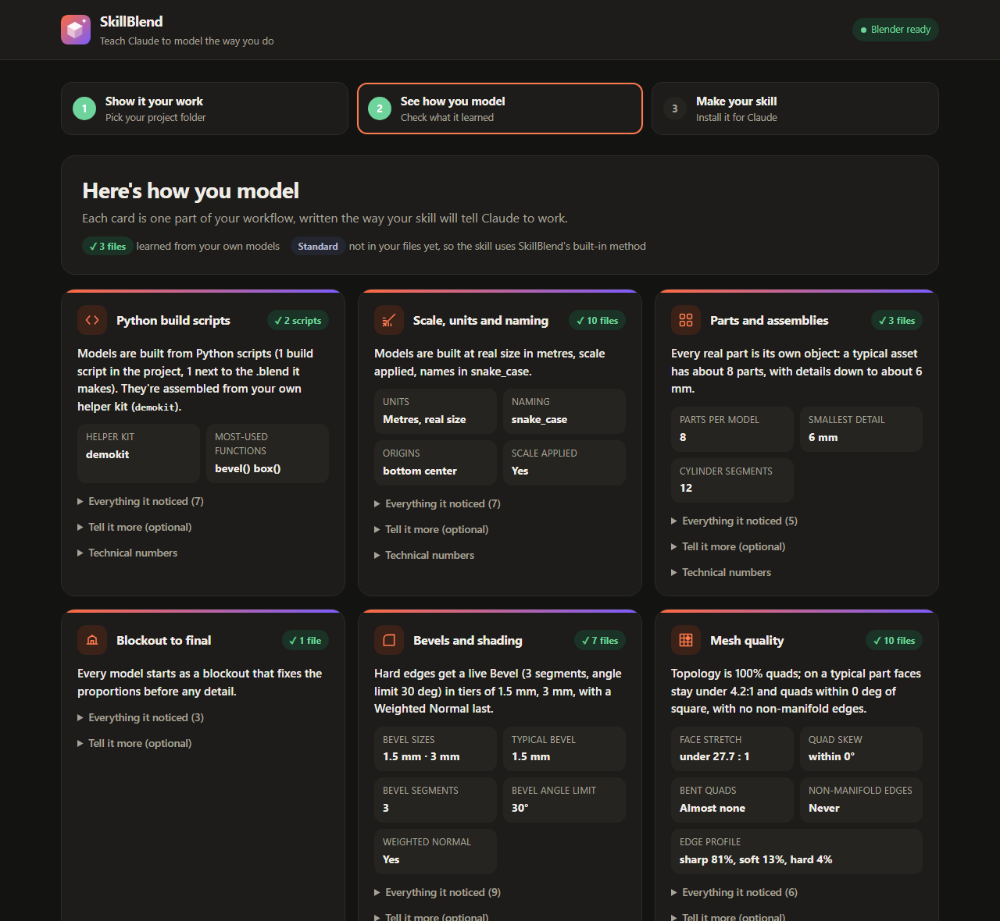
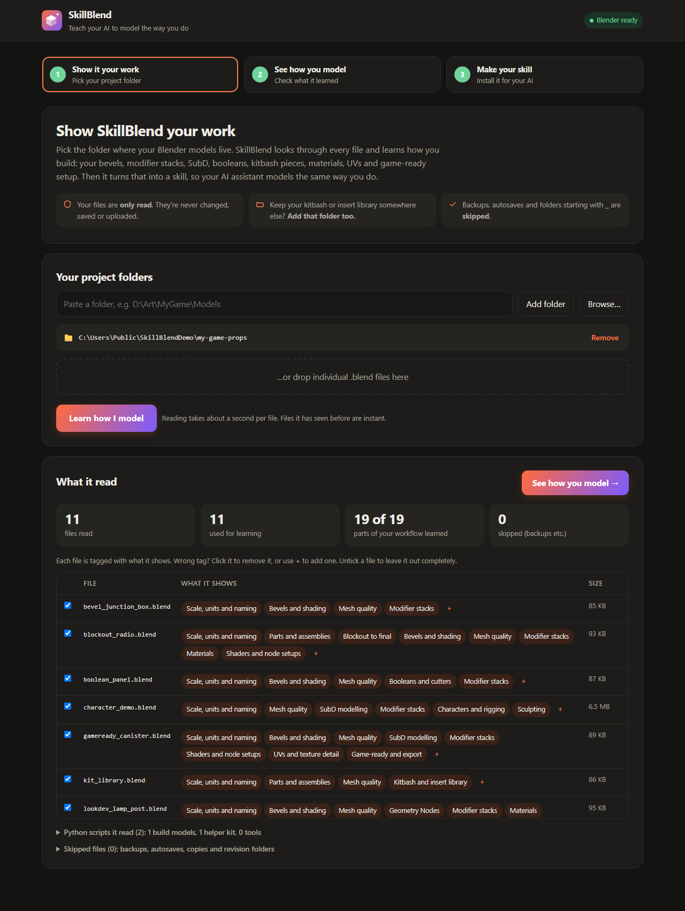
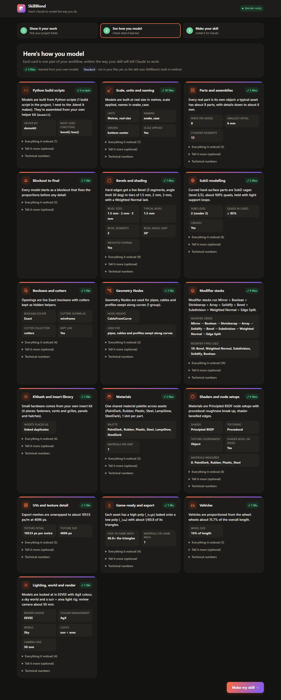
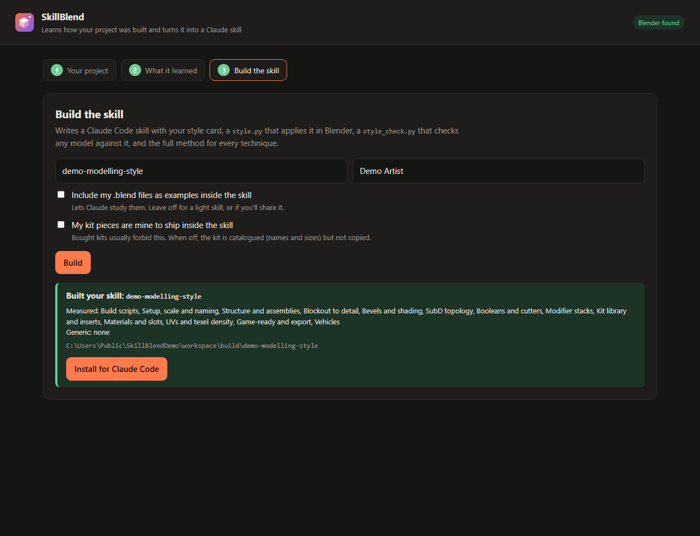
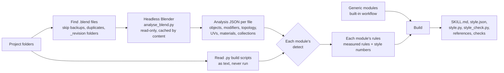

<p align="center">
  
</p>

<h1 align="center">SkillBlend</h1>

<p align="center"><b>Point it at your Blender project. It learns how you model and writes a Claude Code skill that models the same way.</b></p>

<p align="center">
  
</p>

SkillBlend is a local app for Blender artists who use [Claude Code](https://claude.com/claude-code). Point it at your project. It reads your `.blend` files (and the Python build scripts next to them, if you have any) and works out how you build models: how you bevel, your stack order, how you hold SubD edges, how you cut openings, your kit pieces, your material palette, your texel density, your high/low setup. Then it writes all of that into a **skill**: a folder Claude Code loads so that when you ask it to model something in Blender, it works your way and checks its own result against your style.

- **Nothing to fill in.** You don't answer an interview or tag files. SkillBlend sorts your files by technique itself.
- **Measured, not guessed.** Every rule in the skill comes from your files, with the numbers and how many files they came from.
- **Original work.** The built-in workflow is written from SkillBlend's own models, measurements and Blender tests (see [Acknowledgements](#acknowledgements) for where it started).
- **Gaps are covered.** Any technique your project doesn't show uses a complete, tested built-in workflow.
- **Local and read-only.** Blender opens your files in the background and never saves them. Nothing is uploaded.

---

## Contents

- [Quick start](#quick-start)
- [Using the app, step by step](#using-the-app-step-by-step)
- [What you get](#what-you-get)
- [How it works](#how-it-works) (the full version is in [docs/how-it-works.md](docs/how-it-works.md))
- [What it learns](#what-it-learns)
- [Command line](#command-line)
- [Privacy and licences](#privacy-and-licences)
- [Extending SkillBlend](#extending-skillblend)
- [Tests](#tests)

## Quick start

**You need:** Blender 4.2 or newer (developed and tested on 5.2), Python 3.9 or newer (no packages to install), and a web browser. Claude Code is needed to *use* the skill you build.

```bash
git clone https://github.com/1337VIPER/skillblend.git
cd skillblend
python skillblend.py app
```

Your browser opens SkillBlend at `http://127.0.0.1:4970`. If Blender isn't found automatically, the app asks for the path to `blender.exe` (or the Blender app on macOS / the `blender` binary on Linux).

**No project to hand?** Make the demo project and learn that:

```bash
python skillblend.py demo        # writes workspace/demo-project: 9 small .blend files and a build script
```

Then add `workspace/demo-project` as your project folder in the app.

## Using the app, step by step

### 1. Your project

Add the folder your models live in, by typing or pasting a path or with **Browse…**. Add more folders if your project uses a kit or insert library stored somewhere else. You can also drop `.blend` files straight onto the page. Then press **Learn my style**.

<p align="center"></p>

SkillBlend then:

- **finds** every `.blend` in those folders and skips backups, autosaves, `.blend1` files, exact duplicates and revision folders (any folder whose name starts with `_`, like `_prev`, `_review` or `_stages`);
- **reads** each file in Blender running in the background, with no window. Results are cached by file content, so the next scan only reads new or changed files;
- **reads your Python scripts** as plain text (it never runs them), to find which scripts build models, which helper kit they import and which operations you call most;
- **sorts** the files: every technique module looks at every file and says whether it shows that technique, and why.

The file table shows the result. Each chip is a technique the file shows; hover it to see why. Click a chip to switch a technique off for that file, or use **+** to add one. A dashed chip marks your override. Untick a file to leave it out entirely.

### 2. What it learned

One card per technique. **Measured** cards come from your files. **Generic** cards mean no file showed that technique, so the skill uses the built-in method there. Each card leads with a one-line summary, then the measured rules, then the style numbers that go into the skill. Warnings (amber) point out anything that looks off.

<p align="center"></p>

**Optional details** on each card let you add what a file can't show, such as which way your models face or which baker you use. You don't have to fill any of them in.

### 3. Build the skill

Name the skill and optionally credit yourself. Choose whether to include your `.blend` files as examples inside the skill: this lets Claude study them, but leave it off for a lighter skill or one you'll share. If your kit pieces are yours to ship, tick that box too. Then press **Build** and **Install for Claude Code**. Start a new Claude Code session and the skill is loaded.

<p align="center"></p>

## What you get

A skill folder, installed to `~/.claude/skills/<name>/`:

| File | What it's for |
|---|---|
| `SKILL.md` | The skill Claude reads. It opens with **How this project is built**, a numbered summary in the order the work happens, then how to work, a style card of every number, and one section per technique marked *measured* or *generic*. |
| `style.json` | Every style number, and where it came from: measured from N files, your answer, or the generic default. |
| `scripts/style.py` | Applies your style inside Blender: `style.setup_scene()`, `style.name("radio knob")`, `style.box(...)`, `style.bevel(obj)`, `style.finish(obj)`, `style.subd(obj)`, `style.cutter(target, cutter)`, `style.order_stack(obj)`, `style.material(obj)`, `style.kit_piece("screw_m3")`, `style.texel_density(obj)`. |
| `scripts/style_check.py` | Checks any `.blend` against your style and lists what's off, ending in `STYLE ok` or a count of warnings. Claude runs it before calling a model done. |
| `references/` | The full method for each technique, with your measurements on top, plus your kit catalogue. |
| `examples/`, `kit/` | Your files, build scripts and helper kit, only if you chose to include them. |

Here's what the start of a built `SKILL.md` looks like (from the demo project):

```markdown
## How this project is built

1. Models are built from Python scripts (1 build script in the project, 1 next to the .blend it makes).
2. They're assembled from the artist's own helper kit (`demokit`).
3. Models are built at real size in metres, scale applied, names in snake_case.
4. Every real part is its own object: a typical asset has about 8 parts, with details down to about 6 mm.
5. Every model starts as a blockout that fixes the proportions before any detail.
6. Hard edges get a live Bevel (3 segments, angle limit 30 deg), about 1.5 mm, with a Weighted Normal last.
7. Curved hard-surface parts are SubD cages (level 2/2), about 100% quads, held with tight support loops.
8. Openings are live EXACT booleans with cutters kept as hidden helpers.
9. Modifier stacks run MIRROR > BOOLEAN > ARRAY > SOLIDIFY > BEVEL > SUBSURF > WEIGHTED_NORMAL.
...
```

When you then ask Claude Code to "model a field radio", the skill tells it to build the model as a script with your helper kit and `style.py`, using your bevel tiers, stack order, naming and materials, and to run `style_check.py` before calling it done.

## How it works



1. **Analysis.** `forge/blender/analyse_blend.py` runs inside Blender (`blender -b --factory-startup FILE --python analyse_blend.py`) and writes one JSON document per file. It covers units and scale; every object's transform, origin, collections and parent; each modifier with its settings; mesh topology (quads, n-gons, poles, n-gon cap sizes, support-loop tightness, surface area); shading marks (sharp, crease, bevel weight, custom normals); UV islands, texel density and packing; materials and their node types; and pivot empties. It only reads the file.
2. **Detection.** Every technique module has a `detect(doc)` function that says whether a file shows its technique, and why: "400 of 654 parts with live bevels", "game file of a high/low set". A module can also look across files, for example pairing `x.blend` with `x_low.blend` and `x_game.blend`.
3. **Rules.** Each module's `rules(ctx)` turns its files into rules, a one-line summary and style numbers. Examples: bevel widths are clustered into tiers in log space; the stack order is a majority-vote ordering across every modifier stack in the project; texel density is reported as a range when it follows asset size.
4. **Build.** Numbers are merged in order: generic default, then measured, then your answer. `SKILL.md` gets the overview, the style card and each module's measured rules plus its method. Each module's `check.py` is shipped so `style_check.py` can hold Claude to your style.

The details are in **[docs/how-it-works.md](docs/how-it-works.md)**.

## What it learns

| Module | Picks files that… | Learns |
|---|---|---|
| Build scripts | are Python scripts that use `bpy` | which scripts build models (and which are checks or renders), your helper kit and its functions, your most-called operations, script structure |
| Setup, scale and naming | are source files (not merged exports) | units, real sizes, applied scale, origins, naming case and prefixes, collections |
| Structure and assemblies | have 5 or more parts | parts per asset, the smallest detail, detail density by part size, round-part segment counts, assembly collections and asset codes, parenting, pivot/socket empties |
| Blockout to detail | have a `Blockout` collection | part and triangle growth from blockout to final, how far the size drifts, reference setup |
| Bevels and shading | have live bevels or bevel weights | bevel tiers, segments, limit method, profile, harden normals, clamp, weighted normals, smoothing |
| SubD topology | have live Subdivision Surface | levels, creases, quad share, support-loop tightness, poles |
| Booleans and cutters | have live Boolean modifiers | solver, operand type, cutter display, naming, collection, parenting, position in the stack |
| Modifier stacks | have live modifier stacks | the project-wide stack order, mirror, array, solidify, skin and curve habits |
| Kit library and inserts | are kit libraries (asset-marked or stored pieces) or place many inserts | a catalogue of pieces and sizes, high/low insert pairs, how inserts are placed |
| Materials and slots | assign 2 or more materials | your palette, the shared library across assets, slots per part, procedural or image shaders |
| UVs and texel density | hold unwrapped export meshes | texel density (and its range), island density spread, packing, seams, UV channels, UDIMs |
| Game-ready and export | are high/low/game/LOD files or pairs | high/low naming, triangle ratio, LOD count, material slots on the game mesh, triangulation |
| Vehicles | have at least 3 wheel or tyre parts | overall proportions, wheel size relative to length |

## Command line

Everything the app does is also available from the command line:

```bash
python skillblend.py config --blender "/path/to/blender"
python skillblend.py learn "D:/Art/MyGame" "D:/Art/Kits"     # one or more folders
python skillblend.py report                                  # what it learned, per technique
python skillblend.py build --name my-style                   # or: learn ... --build
python skillblend.py install workspace/build/my-style        # into ~/.claude/skills/
```

Other commands:
- `demo` writes the demo project.
- `analyse` re-reads every file.
- `build --generic` builds the built-in skill with no files.
- `build --no-examples` leaves your files out of the skill.
- `build --exclude vehicles` drops a technique.
- `install --scope project --project-dir DIR` installs the skill into one project.
- `python skillblend.py --help` lists everything.

**Guided interview (optional).** If you'd rather make example models on purpose, run `python skillblend.py install-driver` and tell Claude Code "start skillblend". Claude asks for one specific model per technique (`request`, `submit`, `questions`, `answer`). Submitted models and a learned project combine.

## Privacy and licences

- **Your files stay on your machine.** Blender opens them read-only in the background and never saves them. Files you drop into the app are copied to `workspace/uploads/`. Nothing is sent anywhere.
- **The app is local-only.** It listens on `127.0.0.1` only, and every request must carry a token written into the page, so other websites can't drive it.
- **Built skills include your files only if you ask** ("Include my .blend files as examples"). Turn this off before sharing a skill. With examples on, your build scripts are copied too, and they may contain local paths.
- **Kits:** kit files are copied into the skill only if you confirm they're yours to ship. Bought kits are catalogued (names and sizes) but never copied.

## Extending SkillBlend

A technique is a folder in `modules/`. Add one and SkillBlend picks it up.

| File | Purpose |
|---|---|
| `module.json` | `id`, `order`, `title`, `summary`, `optional`, `request` (what the guided interview asks for), `questions`, optional `source: "scripts"` or `bundle` |
| `rules.py` | `detect(doc, L)` returns a reason string when a file shows the technique, or `None`. `rules(ctx)` writes `ctx.result.rule()`, `.headline()`, `.number()` and `.warn()`. Optional `detect_project(docs, L, picked)` handles techniques spread across files. |
| `check.py` | `check(doc, style) -> [(severity, message)]`, shipped into every built skill's `style_check.py` |
| `generic.md` | The built-in method. The part above `<!-- more -->` goes into `SKILL.md`; the rest goes into `references/` |
| `defaults.json` | Generic style numbers (keys starting with `_` are notes) |
| `scripts/` | Helper scripts copied into the skill's `scripts/` |

`forge/blender/analyse_blend.py` defines what's in an analysis document, and `forge/lib/doclib.py` has helpers for reading one. [docs/how-it-works.md](docs/how-it-works.md) documents both.

## Tests

```bash
python tests/run_tests.py
```

The suite needs Blender and runs end to end in a temporary workspace. It:
- makes the demo files and submits them;
- builds a personal and a generic skill;
- builds a model with the skill's `style.py`;
- checks a clean model and a careless one with `style_check.py`;
- learns a folder and checks that each technique lands on the right file;
- smoke-tests the app's API and its token check.

## Acknowledgements

Early versions of SkillBlend's built-in workflow (up to commit `d7fb05b`) adapted ideas from two MIT-licensed Claude skills: [arjun988/blender-skills](https://github.com/arjun988/blender-skills) ("hard-surface" and "prop-artist") and [garyhtou/claude-plugins](https://github.com/garyhtou/claude-plugins) ("building-3d-for-web"). Thank you to both authors; their work helped shape where this project started.

Since then the workflow has been rewritten from SkillBlend's own data: bevel widths measured across a 23-asset portfolio, pivot and detail rules from measured files, and export behaviour re-tested in Blender 5.2. Those tests updated one earlier assumption: `shade_auto_smooth` does work headless in current Blender. The current text and numbers are original to this project.

## License

MIT. See [LICENSE](LICENSE).
